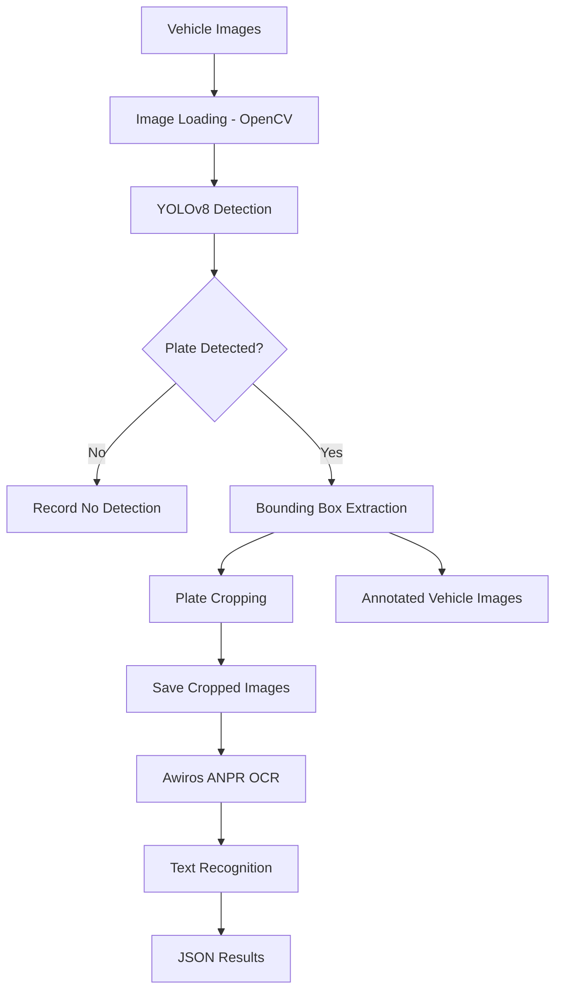

# Automatic Number Plate Recognition (ANPR)


**An image-based Automatic Number Plate Recognition system built using Python, YOLOv8, OpenCV and deep learning-based OCR.**

This project aims to automate vehicle license plate detection and text recognition from images. It combines object detection and optical character recognition (OCR) to identify license plates, extract their contents and store the recognition results in a structured format.

The system is designed with a modular workflow, keeping license plate detection and text recognition as separate stages. This makes it easier to improve individual components and eventually extend the system to video-based and real-time recognition.

---


## Table of Contents

- [Overview](#overview)
- [Objectives](#objectives)
- [System Architecture](#system-architecture)
- [Technology Stack](#technology-stack)
- [Project Workflow](#project-workflow)
- [Project Structure](#project-structure)
- [Prerequisites](#prerequisites)
- [Installation and Setup](#installation-and-setup)
- [Configuration](#configuration)
- [Execution](#execution)
- [Output](#output)
- [How It Works](#how-it-works)
- [Current Limitations](#current-limitations)
- [Future Enhancements](#future-enhancements)
- [References](#references)

---

## Overview

Automatic Number Plate Recognition (ANPR), also known as License Plate Recognition (LPR), is a computer vision application that identifies vehicle registration plates and extracts the alphanumeric information printed on them.

This project implements an image-based ANPR pipeline using two primary machine learning components:

1. **YOLOv8 – Object Detection:** Identifies the location of license plates within vehicle images and extracts the corresponding regions.
2. **Awiros ANPR OCR – Text Recognition:** Processes the extracted plate images and recognizes the registration characters.

OpenCV handles image loading, cropping, annotation and output generation, while Python coordinates the complete workflow.

The current implementation supports processing multiple vehicle images in a single execution.

## Objectives

The primary objectives of this project are:

- Automate license plate detection from vehicle images.
- Extract license plate regions without manual intervention.
- Recognize alphanumeric registration characters using OCR.
- Process multiple images in a single execution.
- Store detection and recognition results in structured output files.
- Build a foundation for future video-based ANPR implementation.

## System Architecture

The system follows a sequential detection and recognition architecture.



The detection and recognition stages are independent. YOLO identifies *where* the plate is located, while OCR attempts to determine *what* is written on it.

## Technology Stack

| Technology | Purpose |
|---|---|
| Python | Core programming language |
| OpenCV | Image processing, cropping and annotation |
| YOLOv8 | License plate object detection |
| Ultralytics | YOLO model loading and inference |
| PaddlePaddle | Deep learning inference framework |
| Awiros ANPR OCR | License plate text recognition |
| Hugging Face Hub | Model weight distribution |
| JSON | Structured recognition output |

### Key Components

**1. YOLOv8**

YOLO (You Only Look Once) is an object detection architecture used to identify license plates within vehicle images.

The project uses a pretrained license plate detection model obtained through Hugging Face Hub.

Model repository:  
https://huggingface.co/Koushim/yolov8-license-plate-detection

**2. Awiros ANPR OCR**

A dedicated OCR model is used to recognize the alphanumeric characters present in the cropped license plate images.

The model is distributed separately and requires its inference script and supporting files.

Model repository:  
https://huggingface.co/Awiros/anpr-ocr

**3. OpenCV**

OpenCV is responsible for:
- Reading vehicle images.
- Extracting license plate regions.
- Saving cropped images.
- Drawing bounding boxes.
- Generating annotated output images.

---

## Project Structure

```text
Automatic-Number-Plate-Recognition/
│
├── main.py
│
├── requirements.txt
│
├── README.md
│
├── .gitignore
│
├── PaddleOCR/                  # External OCR source and model files
│   ├── test.py
│   ├── en_dict.txt
│   ├── model.safetensors
│   └── ...
│
└── output/
    │
    ├── plates_original/        # Input vehicle images
    │
    ├── plates/                 # YOLO-generated plate crops
    │
    ├── annotated/              # Images with detection boxes
    │
    ├── ocr_results.json        # OCR output
    │
    └── ocr_raw.txt             # Raw OCR results
```

**Note:** The `PaddleOCR` directory and `output` directory are maintained locally. They are excluded from the Git repository because they contain external dependencies, model weights, input photographs and generated files.

## Prerequisites

Before running the project, ensure that the following are available:

- Python 3.10 or later (the current development environment uses Python 3.11).
- Windows, Linux or another supported Python environment.
- Internet connection for downloading model weights and dependencies.
- Sufficient memory and storage for deep learning inference.
- Vehicle images in supported formats such as JPG, JPEG and PNG.

The current implementation uses CPU inference for OCR. GPU acceleration has not yet been configured.

## Installation and Setup

### 1. Clone the repository

```bash
git clone https://github.com/YOUR_USERNAME/Automatic-Number-Plate-Recognition.git

cd Automatic-Number-Plate-Recognition
```

### 2. Install Python dependencies

```bash
pip install -r requirements.txt
```

### 3. Prepare the OCR dependencies

Download the PaddleOCR source code as a ZIP archive:

https://github.com/PaddlePaddle/PaddleOCR/archive/refs/heads/main.zip

Extract the source code into the project directory and name the extracted folder `PaddleOCR`.

Obtain the required Awiros model files from:

https://huggingface.co/Awiros/anpr-ocr

Place the required inference script, dictionary and model weights in the expected locations inside the `PaddleOCR` directory.

The OCR model must be configured according to its repository's inference instructions.

### 4. Prepare input images

Create the following directory:

```text
output/plates_original/
```

Place the vehicle images you want to process inside this folder.

Example:

```text
output/
└── plates_original/
    ├── car1.png
    ├── car2.png
    ├── car3.png
    └── car4.png
```

The program creates the generated plate and annotation directories automatically.

## Configuration

The main configuration parameters are defined in `main.py`.

| Parameter | Description |
|---|---|
| `ORIGINAL_DIR` | Directory containing original vehicle images |
| `PLATE_DIR` | Destination for cropped license plates |
| `ANNOTATED_DIR` | Destination for annotated images |
| `PADDLE_DIR` | Location of external OCR dependencies |
| `YOLO_CONFIDENCE` | Minimum detection confidence threshold |
| `HORIZONTAL_PADDING` | Additional horizontal crop margin |
| `VERTICAL_PADDING` | Additional vertical crop margin |

The YOLO confidence threshold can be adjusted depending on the detection requirements.

Lower thresholds may detect more potential plates but can also increase false detections.

## Execution

Once the dependencies, models and input images are configured, execute:

```bash
python main.py
```

The program performs the following operations:

1. Reads all supported images from the original image directory.
2. Loads the pretrained YOLO detection model.
3. Detects license plates in each image.
4. Extracts the detected plate regions using bounding box coordinates.
5. Saves the cropped plate images.
6. Generates annotated versions of the original images.
7. Passes the cropped images to the Awiros OCR inference script.
8. Stores the OCR output in JSON format.

The YOLO weights are downloaded through Hugging Face Hub when they are not already available in the local cache.

## Output

The project generates three primary types of output.

### 1. Cropped License Plates

Detected license plates are saved individually inside:

```text
output/plates/
```

These images are passed to the OCR component for text recognition.

### 2. Annotated Vehicle Images

Images containing detected license plate bounding boxes are saved inside:

```text
output/annotated/
```

These are useful for visually inspecting the performance of the detection model.

### 3. OCR Results

The OCR inference script generates structured recognition results in:

```text
output/ocr_results.json
```

Raw OCR output is also saved in:

```text
output/ocr_raw.txt
```

These files can be used for further processing, analysis and integration with other applications.

---

## How It Works

### Stage 1 – Image Acquisition

The system accepts vehicle images from the configured input directory.

Multiple images can be processed in one execution.

### Stage 2 – License Plate Detection

YOLOv8 processes each image and predicts the location of license plates.

The detection output contains bounding box coordinates and confidence scores.

### Stage 3 – Region Extraction

The bounding box coordinates are used to crop the detected plate from the original image.

A small configurable padding is added around the detected region to reduce the possibility of cutting off characters.

### Stage 4 – Text Recognition

The extracted plate images are passed to the Awiros OCR inference pipeline.

The OCR component attempts to identify the alphanumeric registration text.

### Stage 5 – Result Generation

The system saves the recognition output in JSON format and generates annotated images for visual inspection.

---

## Current Limitations

The project is currently in its initial development stage.

Some known limitations include:

- Recognition accuracy varies depending on image quality and plate visibility.
- Blurry images, reflections, poor lighting and viewing angles can affect results.
- Detection quality depends on the pretrained YOLO model.
- OCR accuracy depends on the quality of the cropped plate images.
- The current implementation is limited to image-based processing.
- No comprehensive cross-format validation or accuracy benchmark has been established yet.
- CPU-based inference can be relatively slow when processing large numbers of images.

The current implementation should be considered an experimental ANPR pipeline rather than a production-ready recognition system.

## Future Enhancements

The project can be extended in several directions.

### Detection Improvements
- Experiment with alternative license plate detection models.
- Improve bounding box precision.
- Introduce image enhancement and perspective correction.
- Evaluate detection performance across different plate layouts.

### OCR Improvements
- Improve recognition accuracy through preprocessing.
- Experiment with additional OCR architectures.
- Introduce confidence-based result filtering.
- Implement registration format validation.
- Evaluate recognition performance against manually verified ground truth.

### Video-Based Recognition
- Add video file input.
- Process video frames for license plate detection.
- Introduce vehicle tracking to avoid repeated recognition.
- Maintain registration results with timestamps.

### Real-Time Processing
- Integrate live camera input.
- Optimize inference performance.
- Introduce GPU acceleration where supported.
- Build a user interface for displaying recognition results.

---

## References

- [Ultralytics YOLO Documentation](https://docs.ultralytics.com/)
- [OpenCV Documentation](https://docs.opencv.org/)
- [PaddlePaddle Documentation](https://www.paddlepaddle.org.cn/)
- [PaddleOCR Repository](https://github.com/PaddlePaddle/PaddleOCR)
- [Awiros ANPR OCR Model](https://huggingface.co/Awiros/anpr-ocr)
- [YOLO License Plate Detection Model](https://huggingface.co/Koushim/yolov8-license-plate-detection)

---

## Disclaimer

This project is developed for educational and experimental purposes to explore computer vision, object detection and optical character recognition.

Recognition results may not always be accurate and should not be treated as verified vehicle registration information.
